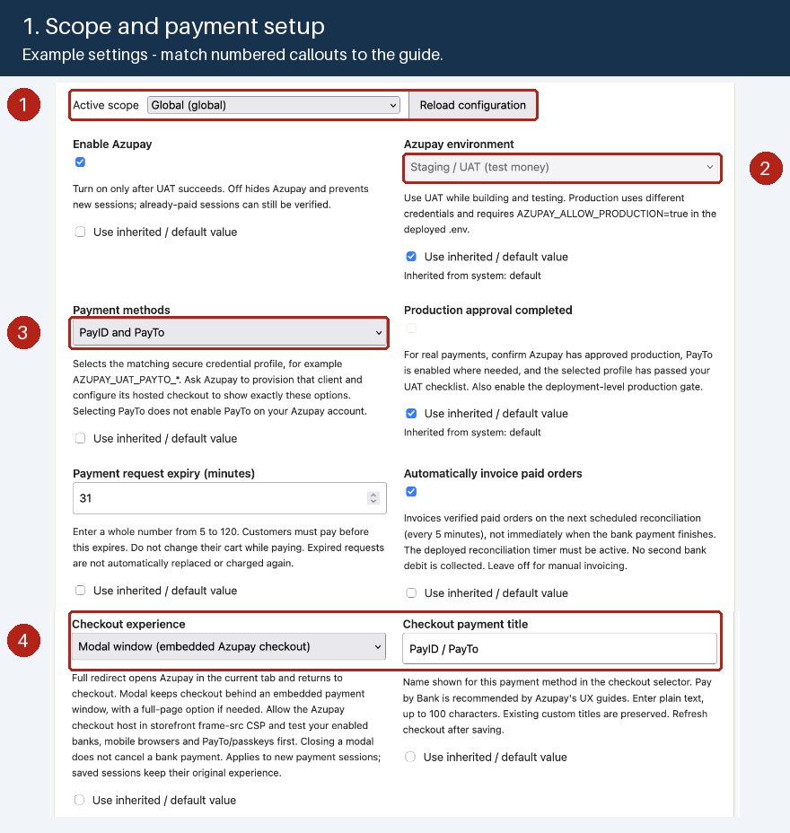
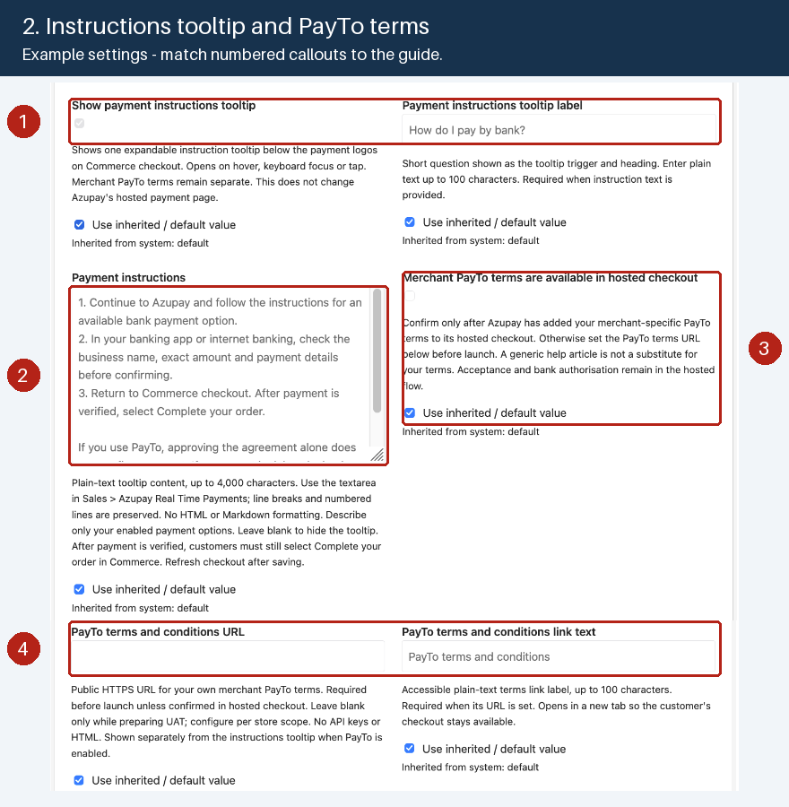
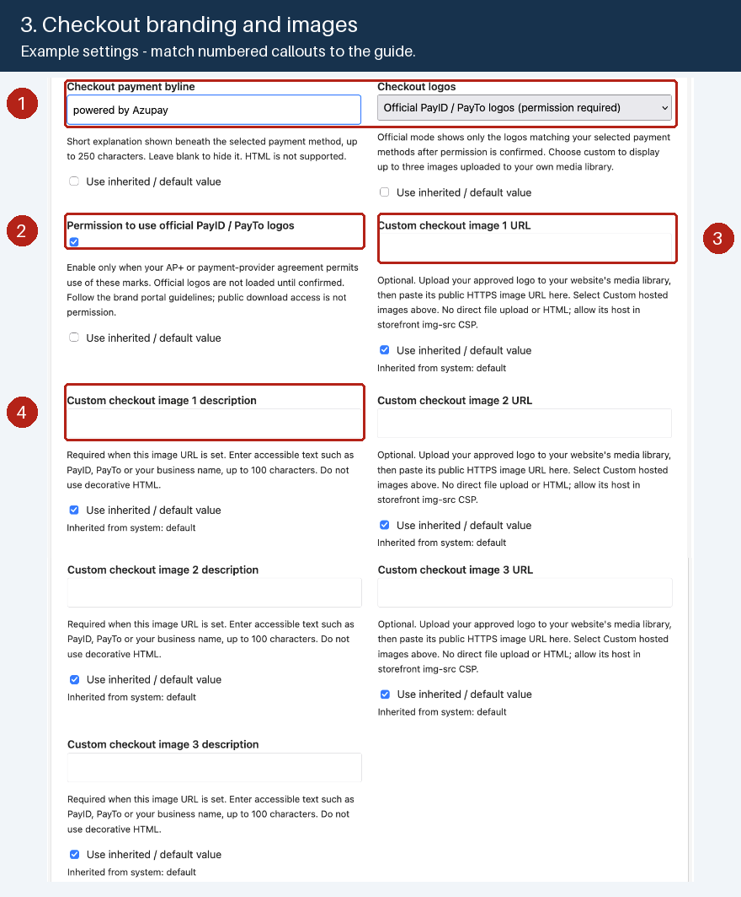
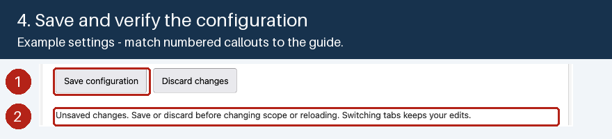

# Azupay Real Time Payments administration

## V2 menu and access

The application declares **Sales > Azupay Real Time Payments** through
`adminUi.menu` in the root Commerce app configuration. It uses the
`commerce/backend-ui/2` extension point and the
`@adobe/aio-commerce-lib-admin-ui/web` SDK to mount its page and receive Adobe
IMS context. It does not use V1 `ExtensionRegistration` or a separate menu
registration Runtime action.

The menu opens **Configuration** by default, with **Documentation** as a second
tab. This V2 page stays in the Commerce Admin iframe so its left navigation
remains available. The Documentation tab contains:

- Instructions for editing the shared, store-scoped App Management settings.
- Azupay UAT/production dashboard links, clearly separated.
- The PayID Test Bank, current PayTo test-account guide and UAT walkthrough.
- Payment completion, invoicing, paid-cart recovery and refund guidance.

The Configuration tab reads and edits the same native configuration storage;
there is no second settings database. It is **not a live payment dashboard or
health check**, and does not fetch API keys, payment records or scheduler state.
IMS tokens are not displayed, persisted or attached to external links. Links open in a new tab
without a referrer or opener. The menu requests only `allow-popups` for those
links. Save validates the form and calls the authenticated API directly, without
depending on native form submission inside the iframe. No unsupported
`allow-forms` override or top-navigation permission is requested.

`aclProtected: true` gives the menu a dedicated per-app Commerce ACL resource.
After installation/upgrade, a Commerce administrator must grant the Azupay menu
permission to the intended roles in **System > Permissions > User Roles**.
The menu permission now grants access to **read and edit Azupay settings through
this page**. Assign it only to roles that should configure payments. The backend
checks that permission with the signed-in admin's forwarded IMS token on every
read/save; it never uses the deployment technical account to authorize the user.
Native App Management access, order access, Azupay dashboard access and refund
privileges remain separate permissions.

If the page is opened outside the authenticated host, it shows an authentication
warning rather than implying an authenticated account connection.

## Configuration inside Commerce Admin

1. Open **Sales > Azupay Real Time Payments**. The Configuration tab is selected.
2. Select the intended global, website, store or store-view scope from the
   existing scope tree. Noneditable scopes are displayed read-only.
3. Clear **Use inherited / default value** for each explicit override you need.
   All fields retain the schema's labels, options and help descriptions.
4. Select **Save configuration**. Only changed fields are patched; checking
   inheritance sends `null` to remove the override rather than copying a parent
   value into the selected scope.
5. A confirmed reload shows the saved values. Refresh storefront checkout to
   load presentation changes.

Switching to Documentation and back retains the current scope and unsaved
draft. Save or discard before changing scope or reloading. After a failed or
ambiguous save, editing is blocked until configuration is reloaded so that a
possibly successful write is not mistaken for a failed one.

### Adding websites, stores or store views

From 0.1.13, use **Sync Commerce scopes** on this Configuration tab after adding
or renaming a Commerce website, store or store view:

1. Save or discard any unsaved configuration. If a save was ambiguous, use
   **Reload configuration** first to confirm the saved values.
2. Select **Sync Commerce scopes** and wait for confirmation. The scope
   selector and settings are disabled while synchronization runs.
3. The dropdown updates without a page reload and preserves the selected scope
   when it still exists; otherwise it selects Global. New scopes inherit their
   parent settings. Review those settings before using a new storefront.

**Reload configuration** reads saved settings for the selected scope; it does
not fetch the latest Commerce hierarchy. A full browser reload reads the app's
persisted scope tree, so it also cannot replace synchronization. Do not rely on
a Sync control being present in Adobe's separate generic configuration page.

The app's scope list is an Adobe-managed saved hierarchy, not a live list on
every page load. Sync uses Adobe's `syncCommerceScopes` library to fetch
`store/websites`, `store/storeGroups` and `store/storeViews` from the associated
Commerce instance. It preserves existing scope UUIDs by Commerce ID and level,
updates the persisted tree/cache and does not edit payment configuration values.
Cached fallback data is treated as a sync failure, not success; the previous
dropdown remains available and an explicit error invites retry.

Sync does **not** register Azupay for additional store-view codes, change
payment credentials, activate real-money production or add support for B2B
purchase-order approval. Review payment-method store registration separately.

The authenticated `azupay/admin-config` adapter reuses Adobe's
`configRuntimeAction` and `scopeTreeRuntimeAction` handlers for configuration
GET/PATCH and scope-tree GET, plus an explicit POST `/scopes/sync` operation.
Sync requires the same signed-in user's Azupay menu ACL; it gets the Commerce
target from the stored association and uses only forwarded admin authentication,
never a browser-supplied target URL or technical-account fallback. Native
storage/encryption are preserved. Custom-scope creation and deletion remain
unavailable through this editor.

The older **Apps > App Management > Configure** route opens Experience Cloud,
not the Commerce Admin iframe. Its missing Commerce sidebar is a host difference,
not a CSS defect in Azupay. This extension does not inject a fake Commerce sidebar
or embed that separate page in a nested iframe.

## Install or upgrade the admin extension

Follow [installation](README.md) for workspace selection and private credentials.
The Adobe project must support **Commerce Admin UI SDK V2**, and the Commerce
tenant must expose the V2 host. Adobe's current
[V2 menu sample](https://github.com/adobe/adobe-commerce-samples/tree/main/admin-ui-sdk/v2/menu/custom-menu)
lists Admin UI SDK 4.2.0+ for V2; confirm availability with your ACCS tenant
administrator. Do not install PHP modules or use V1 as a silent fallback on ACCS.

1. Run `npm ci` and `npm run verify`. Local verification includes a credential-free
   admin browser bundle; it does not prove the Commerce host integration.
2. Check the intended Adobe project/workspace has the V2 extension enabled. The
   source manifest includes `commerce/backend-ui/2` alongside the existing
   extensibility and configuration extensions.
3. Build and deploy all extensions using your private workspace configuration:

   ```sh
   aio app build --force-build
   aio app deploy --no-build --force-deploy
   ```

   Before upgrading an existing installation, follow
   the [versioned release process](PUBLISHING.md#5-prepare-a-versioned-release).
   Reusing an installed metadata version is not a reliable way to trigger an
   lifecycle upgrade. This app explicitly uses `metadata.upgradeMode: "auto"`;
   the post-deploy hook plans and starts upgrades for an existing installation.

4. Complete the Adobe publication/approval flow if prompted. For a first
   installation, use **Install** in Commerce **Apps > App Management**. For an
   existing SDK installation, let the post-deploy automatic lifecycle upgrade
   finish and verify its result; do not assume there is an **Upgrade** button.
   Grant the new menu ACL to the intended roles. Do not uninstall a payment app
   with unsettled or unreconciled payments just to refresh its menu.
5. Sign out/in or reload the Admin if its menu cache needs refreshing. Open
   **Sales > Azupay Real Time Payments** and verify it renders within Commerce.
6. Test both an allowed and a denied admin role, Configuration/Documentation tabs,
   scoped inheritance, saves and external links. If the menu is missing, check V2
   availability, deployed web assets, approval/association state and ACLs.

For an already-published Adobe Production workspace, `--force-deploy` can update
Runtime/CDN assets while reporting **skipping publish phase**. That does not
register a newly added V2 extension point. Coordinate the supported Adobe
Exchange retraction/republication and approval process with the application owner
before expecting the menu to appear. Publication changes can affect availability;
drain and reconcile payments first. Do not delete the Commerce installation as a
substitute.

### No Upgrade button / manual plan does not execute

An **Associated** card with **Install** does not prove the SDK has no installation
baseline. App Management card state and SDK lifecycle state must be checked
separately. SDK 2.0.0 defaults an omitted `metadata.upgradeMode` to `"manual"`:
the deploy hook creates a plan but does not execute it. Its CLI does not expose an
`upgrade apply` command, and this Admin view need not provide an **Upgrade**
control. Repeatedly clicking Install does not override the manual policy.

This app explicitly sets `"auto"` so supported versioned deployments plan and
execute the existing installation's upgrade through Adobe's post-deploy hook.
This policy also applies to future versioned deployments; review plans and UAT
evidence before deploying. Verify lifecycle completion rather than treating a
successful CDN upload as a successful upgrade. If execution fails or times out,
inspect its state before retrying the normal hook. Do not edit SDK state,
invoke internal execution routes, or unassociate to force an upgrade.

See Adobe's [Admin UI SDK overview](https://developer.adobe.com/commerce/extensibility/admin-ui-sdk/)
and [V2 extension contracts](https://developer.adobe.com/commerce/extensibility/admin-ui-sdk/extension-points/v2/).
Live installation, host handshake, menu cache and ACL behavior must be checked
in the target tenant; a standalone browser preview is not that acceptance test.

## App and checkout names

The app display name and admin menu remain **Azupay Real Time Payments**.
From 0.1.9, the shopper-facing default and newly registered OOPE payment title
are **Pay by Bank**, following Azupay's UX naming recommendation. The existing app ID
`azupay-pay-by-bank`, payment code `azupay`, Runtime action names, receipt/session
contracts and storefront installer identity remain unchanged.

Merchant-defined checkout titles are preserved. Existing saved/inherited values
may still contain the old label after an upgrade: open **Apps > App Management >
Azupay Real Time Payments > Configure**, select each applicable scope and set
**Checkout payment title** explicitly to the new name, or retain your custom
name. Reload storefront checkout after saving.

The registration script supplies the new OOPE title when it is run by the
installation lifecycle; changing source alone does not rewrite an existing
Commerce method record. Do not assume a redeploy reruns installation. The
storefront branding hook applies the effective scoped title on supported EDS
checkouts. No manual edits to the merchant's generated browser bundle are needed.

## Illustrated configuration walkthrough

These annotated crops come from the supplied Azupay settings screenshot.
Numbers identify the controls described below; the original screenshot was
left unchanged. Select an image to view it at full size.

**The screenshot is an example, not recommended launch defaults or proof of a
successful save.** It shows a custom title/byline, a 31-minute expiry, modal
checkout, enabled invoicing and an unsaved draft. Start with UAT, a 30-minute
expiry and full redirect, and enable invoicing only after testing reconciliation.
Set logo permission only when your own agreement grants it. Choose values for
your provisioned account and tested storefront rather than copying the image.

### 1. Select scope and payment settings



1. **Active scope:** choose Global, Website, Store or Store View as appropriate.
   Clear **Use inherited / default value** for each override; inherited controls
   are disabled. Save or discard the current draft before switching scope.
2. **Azupay environment:** use Staging / UAT while testing. Production also needs
   separately provisioned credentials, merchant approval and the deployment
   production gate; choosing it here alone cannot enable live payments.
3. **Payment methods:** select the provisioned PayID, PayTo or combined profile.
   This selects credentials; it does not activate a product on your Azupay account.
4. **Checkout experience and title:** start with full redirect, or test modal
   checkout before enabling it. Set your shopper-facing title; the app/menu name
   remains Azupay Real Time Payments.

### 2. Set the instructions tooltip and legal terms



1. **Show payment instructions tooltip / label:** enable the compact popover
   and set its question, up to 100 characters. The default is
   **How do I pay by bank?**.
2. **Payment instructions:** unlock the textarea and enter up to 4,000 plain-text
   characters. Use line breaks or numbered lines for steps. Blank text hides the
   popover. No HTML or Markdown is rendered; no legacy external help URLs are
   needed. Explain only the payment options you offer.
3. **Merchant PayTo terms are available in hosted checkout:** confirm only when
   Azupay has actually configured your merchant terms there. This is not a
   shopper's payment agreement or bank authorisation, and the tooltip is not a
   replacement for legal acceptance.
4. **PayTo terms and conditions URL / link text:** provide your own public HTTPS
   terms URL, up to 2,048 characters, and a nonempty label up to 100 characters.
   When PayTo is enabled, that link appears outside the tooltip and remains
   available even if instructions are hidden. The example URL is blank, which
   must be addressed before launch unless hosted terms are confirmed.

For a simple multiline structure, adapt this original example to your enabled
payment options and hosted flow:

```text
1. Select Pay by Bank and follow the bank payment instructions.
2. Check the business name, amount and payment details in your bank.
3. Return to checkout. Once payment is verified, select Complete your order.

If your bank delays the payment, check with your bank and do not pay again.
```

The popover is on Commerce checkout, not Azupay's hosted page. Check
[customer education and PayTo terms](#customer-education-and-payto-terms) for the
limits and remaining hosted responsibilities.

### 3. Configure the byline and logos



1. **Checkout payment byline / Checkout logos:** enter up to 250 characters of
   byline text or leave it blank. Choose official marks, custom hosted images
   or none.
2. **Permission to use official PayID / PayTo logos:** check only with the
   required rights. The selected payment methods determine which official
   marks load; public portal access is not permission.
3. **Custom checkout image URL:** when using Custom hosted images, upload the
   approved image to your own media library and paste its HTTPS image URL.
   Allow that host in your storefront's `img-src` CSP. There is no direct upload
   in this form.
4. **Custom checkout image description:** provide accessible plain text for each
   configured image. Repeat the URL/description pair for up to three images.
   Checkout constrains images to 100 x 48 CSS-pixel boxes and preserves their
   proportions.

### 4. Save, read back and test



1. **Save configuration:** save the changed fields and wait for a confirmed
   saved message/readback. Restore inheritance by checking **Use inherited /
   default value** and saving. Discard changes abandons the current draft.
2. **Unsaved changes:** the screenshot shows this warning, not a completed save.
   Save or discard before changing scope or reloading. Switching Documentation
   tabs retains the draft. If a save cannot be confirmed, reload authoritative
   values before editing again.

Refresh storefront checkout and check the effective store view. Verify the
tooltip with mouse hover, keyboard focus, Enter/Space and Escape; test tapping on
a real mobile device too. Confirm that only the tooltip is dismissed and that
the separate terms link still works. Complete the
[UAT checklist](OPERATIONS.md#uat-acceptance-checklist) before enabling production.

## White-label checkout and hosted branding

Version 0.1.12 follows Azupay's UX review without changing payment processing:

- Set **Checkout payment title** to **Pay by Bank** and **Checkout payment
  byline** to **Fast and secure**, or appropriate merchant wording. Remove saved
  provider attribution such as "powered by Azupay". Existing overrides are not
  silently rewritten by a schema upgrade.
- **Checkout payment badge** is optional plain text, at most 32 characters.
  Leave it blank for no badge. If using a highlight such as **New**, make sure
  the claim remains accurate. The annotated screenshots above predate this
  field and retain their original example values.
- After upgrading the storefront to 0.1.12, the existing native bank selector
  displays the approved payment logos, byline and badge. Official-mark permission
  remains required; no logos are bundled or enabled without that permission.
  The selected details keep the instruction tooltip and separate terms link.
- Review saved instruction text for provider names too. The new defaults and
  built-in shopper messages use white-label wording, but merchant-authored text
  is preserved. The admin app/menu name remains **Azupay Real Time Payments**.
- The modal heading is **Pay securely from your bank account**. **Close payment
  window** remains visible. **Need help with your payment?** contains **Check
  payment status** (verification only, no new charge) and **Open payment in full
  page** (the same payment, not a new request). Help opens automatically when
  embedding or verification fails, automatic checks pause, or dialogs are
  unsupported.

The page inside the iframe is hosted by Azupay. This extension cannot rename its
merchant/payee, replace its logo or inject links into it. Ask Azupay to configure
the approved merchant identity and merchant-specific PayTo terms for **each
provisioned hosted client**, including separate UAT and production profiles.
For the Adobe Council installation, the requested display name is **Adobe
Council**; Azupay must confirm that it matches the authorised merchant identity.
Do not treat that request as a completed provider configuration change.

Provide your actual merchant PayTo terms URL when ready, or arrange and verify
terms inside hosted checkout. Until then leave the URL and hosted confirmation
unset and keep this as an outstanding launch requirement. A privacy notice alone
is not merchant PayTo terms. Neither this extension's tooltip nor a bank
agreement approval substitutes for the required legal terms and settlement.

## Customer education and PayTo terms

From 0.1.10, Commerce checkout shows one compact instruction popover beneath the
logos instead of long explanatory paragraphs and the education-link list.
In **Sales > Azupay Real Time Payments > Configuration**:

1. Select the store scope and unlock **Payment instructions**.
2. Enter your instructions in the textarea (up to 4,000 characters). Line breaks
   and numbered lines are preserved; HTML and Markdown are displayed as literal
   text, not rendered. Describe only the payment options you have enabled.
3. Optionally change **Payment instructions tooltip label** (up to 100
   characters), default **How do I pay by bank?**.
4. Save, then refresh checkout. Clear the instruction text or turn off
   **Show payment instructions tooltip** to hide it.

The popover opens on mouse hover, keyboard focus or tap. Click/tap again or
press Escape to close it; leaving the popover or moving focus outside also
closes it when appropriate. It uses a native disclosure, not a modal, and does
not trap focus. Long content can be scrolled. Native App Management shares the
same text storage/schema, but its generic text control is host-managed; use the
Sales menu textarea to edit multiple lines.

Merchant PayTo terms remain a separate visible link, even when instructions
are hidden. The tooltip is only on Commerce checkout: it does **not** customize
Azupay's hosted payment page. The content should tell customers to return to
Commerce and select **Complete your order** after server verification; it must
not imply that an agreement approval alone confirms settlement.

From 0.1.11, the five legacy education/approval URL and link-text pairs are
removed from the shared schema and both configuration UIs. Use the combined
instructions textarea instead. Existing saved values for those retired fields
are ignored, including during public branding validation; no old education URLs
are returned to storefronts. Tooltip text, titles, logo settings and payment
processing settings are not reset.

Keep your merchant-specific **PayTo terms and conditions URL** and optional
custom link text. The URL must be absolute HTTPS without credentials, up to
2,048 characters (anchors are allowed); its label must be nonempty plain text
up to 100 characters when a URL is provided. The link opens in a new tab without
an opener or referrer and is returned only when PayTo is enabled.

Review your own tooltip wording against Azupay's
[PayID UX guide](https://helpcentre.azupay.com.au/docs/payid-ux-guide) and
[PayTo UX guide](https://helpcentre.azupay.com.au/docs/payto-ux-guide).
Changes apply after refreshing checkout; API credentials never enter the links.

The existing instructions toggle is reused, not reset. With an older branding
backend, a new storefront puts the legacy enabled-rail instructions inside the
combined popover. Custom textarea content requires the new backend/schema and
the new browser bundle. A new backend does not replace an old storefront's
expanded presentation until that storefront bundle is upgraded.

Before launch, supply your merchant PayTo terms URL, or arrange with Azupay to
host those terms and confirm **Merchant PayTo terms are available in hosted
checkout**. The embedded editor warns when neither is configured. Generic help
or marketing content is not a replacement for your legal terms. The extension
does not invent terms, claim consent was recorded, or add a local checkbox that
could conflict with the hosted payment flow. Review the actual hosted acceptance
and authorisation experience with Azupay.

The combined payment option and existing logo permission gate remain. The editor
also warns when logos are disabled or official logo permission is absent.
Configure approved marks before launch; do not enable permission without usage
rights. Hosted checkout remains responsible for displaying amount, merchant
identity, recipient PayID, payment description/copy controls, PayTo account input,
terms acceptance, approval progress and expiry. Verify all of these in real UAT.
These changes implement the storefront education portions of the guides, not
certification or every optional recommendation (such as incentives/cashback).

## Payment priority and native Commerce ordering

The integration preserves the exact `available_payment_methods` order returned
by Commerce and does not select/reorder other methods. Continue configuring
other methods' native **Sort Order** in Commerce Admin.

The current ACCS OOPE REST schema has no top-level `sort_order` property. A
read-only check of the tenant's `system/config` API returned native sort orders
for standard methods but did not expose `payment/azupay/sort_order`. The
system-config update API accepts only allowed/visible/ACL-authorized paths.
There is therefore no supported numeric Azupay priority control in this version;
the app does not offer a nonfunctional field, guess another method's priority,
or force Azupay to the top. A custom storefront that reorders methods independently
must be reviewed separately.

See Adobe's [OOPE payment API](https://developer.adobe.com/commerce/extensibility/starter-kit/checkout/payment-reference)
and [ACCS REST reference](https://developer.adobe.com/commerce/webapi/reference/rest/saas/).

## PHP extension comparison

Reviewed against Azupay's Marketplace
[Real Time Payments listing](https://commercemarketplace.adobe.com/azupay-payments.html)
and [PHP extension v2.0.0 user manual](https://commercemarketplace.adobe.com/media/catalog/product/azupay-payments-2-0-0-ece/user_guides.pdf),
particularly sections 3-7. This is a feature comparison, not a claim of feature
parity or certification; the PHP module targets a different deployment model.

| PHP setting or feature | This ACCS/App Builder implementation |
| --- | --- |
| Enable/disable and customer-facing title | Supported in native scoped configuration; title, byline and logos are configurable |
| Test/production selection and API key | UAT/production selection supported; keys deliberately remain in private deployment profiles, not browser/admin form fields |
| Checkout App enablement, payment options, company logo/accent | Configure Azupay's hosted Checkout App in its merchant dashboard; Commerce-side branding does not replace hosted appearance settings |
| Payment method sort order | Native Commerce order is preserved; current ACCS OOPE API does not expose an editable numeric Azupay sort order |
| Debug switch and local Magento log files | No merchant-facing debug toggle or PHP log files; use restricted App Builder activations and error codes without exposing payment payloads or tokens |
| Automatic invoice after payment | Supported through independent server verification and scheduled reconciliation, normally within the next five-minute run rather than an immediate provider callback |
| Full and partial online refunds through credit memos | Not implemented; `can_refund` remains false. Use an authorized dashboard refund and matching offline Commerce credit memo |
| Payment information and transaction search | Commerce orders/invoices plus Azupay dashboard; no embedded transaction search or reporting screen yet |
| Cart restoration after cancellation | Existing cart/session retained; modal close is not bank cancellation. A closed/expired payment needs reconciliation before a fresh attempt |
| PayID and PayTo UAT | Documented Test Bank and current fictitious accounts; test both presentation modes |

The PHP manual's invoice-ID transaction search does **not** apply here:
this app uses a deterministic `commerce-<hash>` client transaction ID bound to
the quote/store/amount/profile, with the quote ID in the description. Use the
request ID or that transaction ID for authorized dashboard investigation.
Likewise, only API status `COMPLETE` is accepted; do not substitute UI wording
such as `COMPLETED`, or treat PayTo agreement `ACTIVE` as payment completion.

For current test hosts/accounts, prefer Azupay's
[online testing guide](https://developer.azupay.com.au/docs/test-accounts-1-click-checkout)
over older examples in the PHP PDF. Use the
[demo/UAT walkthrough](OPERATIONS.md#demo-and-uat-with-the-azupay-test-bank)
and [refund runbook](OPERATIONS.md#refunds-and-credit-memos).
